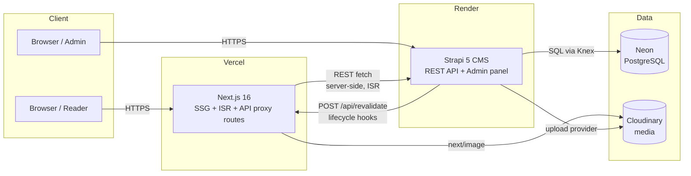
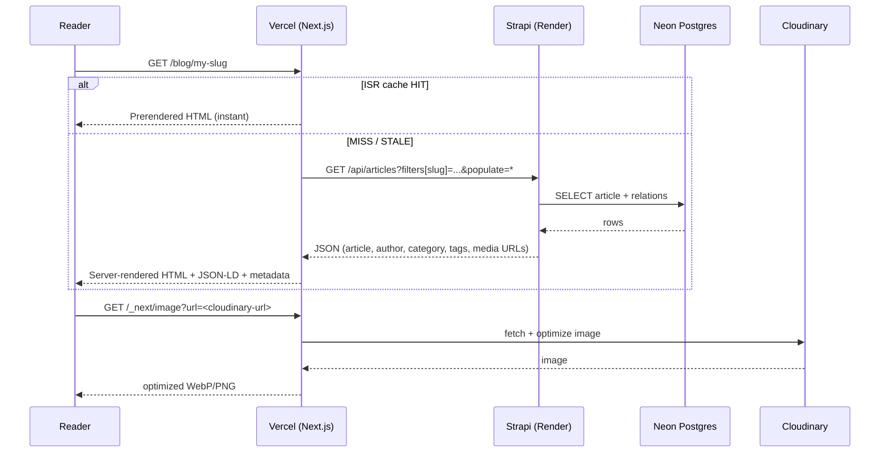
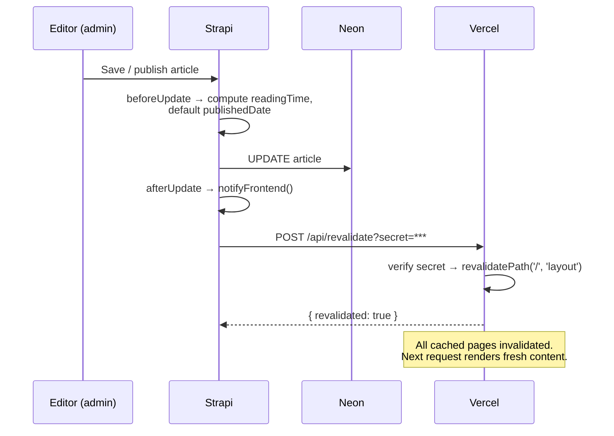
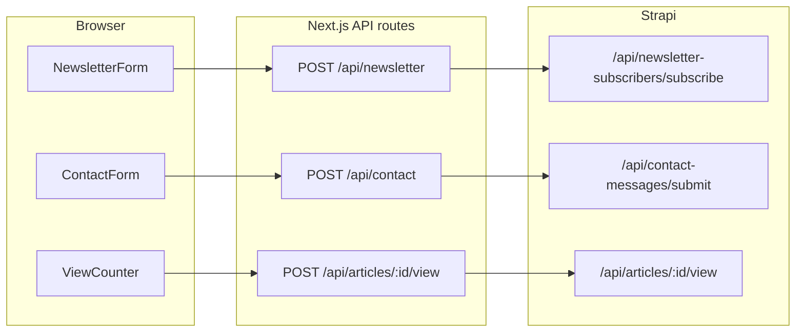
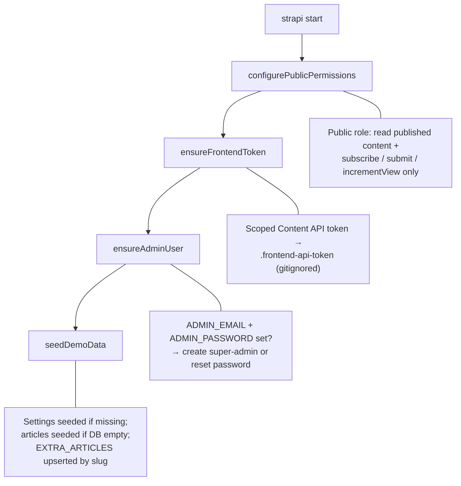
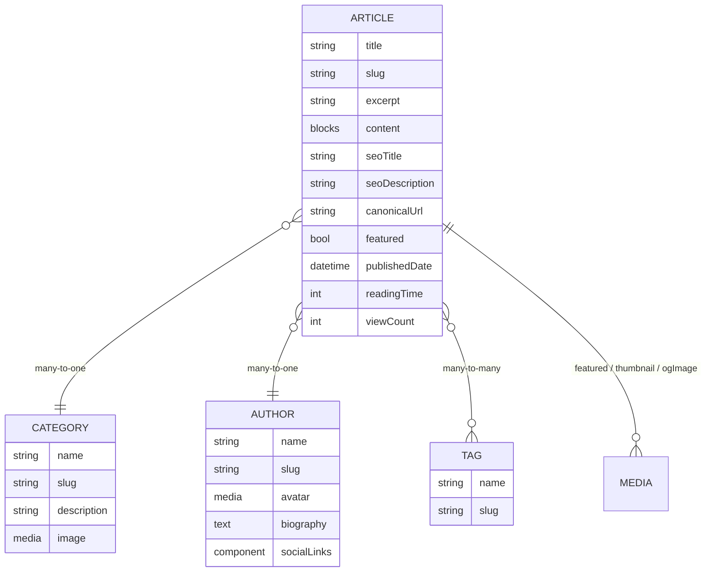
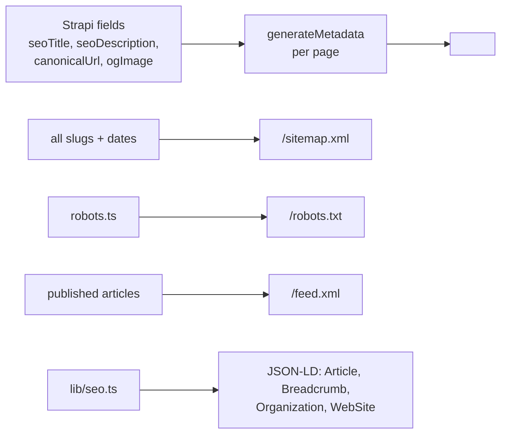
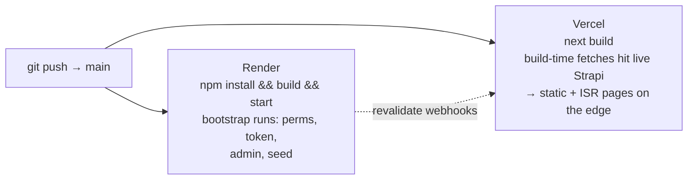

# Meridian — System Architecture

A complete walkthrough of how the Strapi CMS + Next.js blog platform works:
every layer, every request path, and the role of each technology.

- **Live site:** https://strapi-cms-five.vercel.app
- **CMS admin:** https://strapi-cms-krxg.onrender.com/admin
- **Repository:** github.com/hrutikpujari/strapi-cms

---

## 1. High-level architecture

One sentence: **Strapi owns content and logic, Next.js owns presentation and
caching, and env vars wire them together — nothing hardcoded.**

---

## 2. Technology roles

| Layer | Technology | Responsibility |
|---|---|---|
| Public site | Next.js 16 + React 19 + TypeScript | Server-rendered pages, ISR cache, SEO output |
| Styling | Tailwind CSS v4 | All frontend styling, zero runtime CSS-in-JS |
| CMS + API | Strapi 5 | Content modeling, admin UI, REST API, auth, uploads |
| Runtime | Node.js 24 | Runs both Strapi and Next.js |
| Production DB | Neon (Postgres) | Serverless Postgres via `DATABASE_URL` |
| Development DB | SQLite (`better-sqlite3`) | Zero-setup local DB — same config file |
| Media | Cloudinary | Image hosting + transformation in production |
| Frontend host | Vercel | SSG/ISR builds, edge-served pages, deploys on push |
| Backend host | Render | Strapi Node web service, deploys on push |
| Cache invalidation | `revalidatePath` + Strapi lifecycles | Instant publish → live |
| UI extras | Lucide React, Framer Motion | Icons and animations (client components only) |

---

## 3. Read path — a reader opens an article

## 4. Publish path — instant revalidation

The same flow runs on `afterCreate` and `afterDelete`, so edits, publishes,
unpublishes, and deletions all go live within seconds — no 60-second ISR wait.

## 5. Mutation paths — browser → proxy → Strapi

Browser-side JavaScript never calls Strapi directly. Every public write goes
through a same-origin Next.js route, which validates and forwards server-side.
This eliminates CORS entirely and keeps `STRAPI_API_TOKEN` server-only.

| Route | Validates | Strapi side effect |
|---|---|---|
| `/api/newsletter` | email format | dedupes + stores subscriber |
| `/api/contact` | name/email/message, length caps | stores message with `status: new` |
| `/api/articles/:id/view` | documentId | `viewCount + 1` (triggers revalidate too) |

## 6. Strapi bootstrap — what runs on every boot

Files: `backend/src/bootstrap/{permissions,api-token,admin-user,seed}.ts`,
wired in `backend/src/index.ts`.

## 7. Content model

Plus three standalone types:

- **Website Setting** (single type) — site name, logo, favicon, social links,
  contact email, footer content, default SEO
- **Newsletter Subscriber** — email, status, subscribedAt
- **Contact Message** — name, email, subject, message, status, submittedAt

## 8. SEO pipeline (all server-rendered)

## 9. Dev vs production — same code, env-driven

| Concern | Local | Production |
|---|---|---|
| Database | SQLite `.tmp/data.db` | `DATABASE_CLIENT=postgres` + `DATABASE_URL` → Neon |
| Media | `public/uploads` (or Cloudinary when env set) | Cloudinary |
| Frontend | `npm run dev/start` → :3000 | Vercel, auto-deploy on push |
| Backend | `strapi develop` → :1337 | Render, auto-deploy on push |
| Secrets | `.env`, `.env.local` (gitignored) | Render / Vercel env dashboards |

## 10. Deploy pipeline

## 11. Security model

- Public role = **read-only published content** + three controlled mutations
  (`subscribe`, `contact submit`, `view increment`). Everything else requires
  the admin session or a scoped API token.
- `STRAPI_API_TOKEN` lives only in server-side env — never `NEXT_PUBLIC_*`.
- Browser writes always go through Next.js proxy routes that validate first.
- In-memory rate limiting on `/api/*` (per IP; replace with CDN/edge limits
  at scale).
- CORS locked to the site origin.
- Upload provider has an allowlist/denylist of MIME types.
- Secrets rotated for production (fresh `APP_KEYS`, JWT secrets, revalidate
  secret) — dev secrets never shipped.
