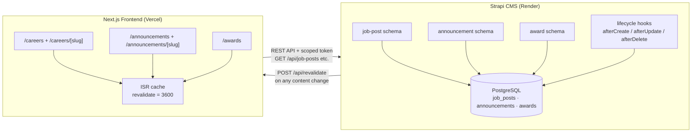
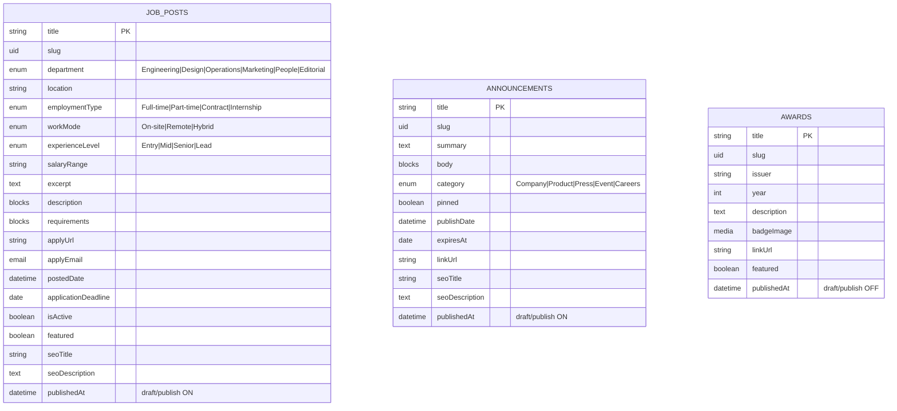
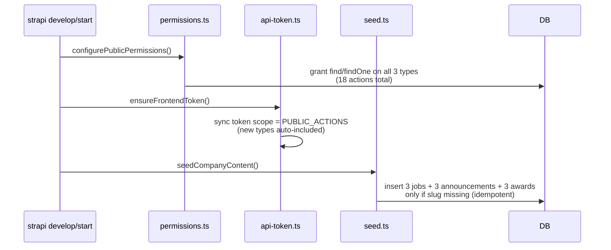
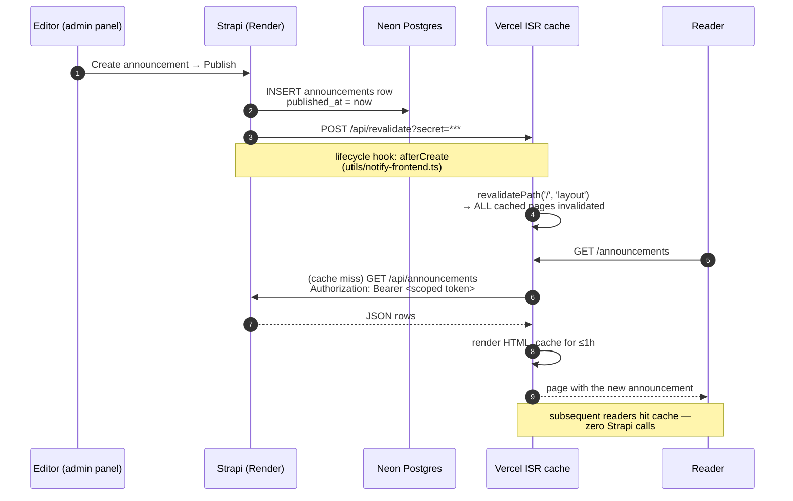

# Company Features: Job Posts, Announcements & Awards

How the three CMS-driven sections work end-to-end — schema, API, bootstrap,
frontend, caching, and instant-publish flow.

## 1. The big picture



**The rule that makes it "CMS-driven":** the frontend knows only the *routes*
and *field names* — every row of content lives in the database and is authored
in the Strapi admin. Adding a job post, announcement, or award is a **database
insert**, never a code change.

## 2. Content model



Design decisions worth noting:

- **`draftAndPublish: true`** on job posts & announcements → "Save" creates a
  draft invisible to the public API; only **Publish** exposes it. Awards are
  simple facts, so drafts are off.
- **Blocks fields** (`description`, `requirements`, `body`) → rich text
  rendered by the shared `BlocksRenderer` on the frontend.
- **`expiresAt`** on announcements → frontend filters them out of the list
  automatically after the date — no cron needed.
- **`isActive`** on job posts → closes a role without deleting it.

## 3. Backend anatomy — one content type, four files

Every type is generated by Strapi's core factories; zero custom code per type:

```
backend/src/api/
├── job-post/
│   ├── content-types/job-post/schema.json   ← field definitions (the contract)
│   ├── content-types/job-post/lifecycles.ts ← revalidation hooks
│   ├── routes/job-post.ts                   ← createCoreRouter → REST API
│   ├── controllers/job-post.ts              ← createCoreController → CRUD
│   └── services/job-post.ts                 ← createCoreService → DB layer
├── announcement/      (same 5 files)
└── award/             (same 5 files)
```

At boot, Strapi reads each `src/api/*` folder and registers:

| Endpoint | Visibility | Purpose |
|---|---|---|
| `GET /api/job-posts` | Public + token | List open roles |
| `GET /api/job-posts/:id` | Public + token | One role |
| `POST/PUT/DELETE` | Admin panel only | Manage content |
| `GET /api/announcements` + `/:id` | Public + token | News list/detail |
| `GET /api/awards` + `/:id` | Public + token | Recognition list |

## 4. Bootstrap — what runs on every deploy



**The token-sync fix (`api-token.ts`)** — the subtlest bug we hit: the frontend
token was created once with the original 12-action scope. New content types
returned 403 until `PUBLIC_ACTIONS` grew. Now the bootstrap *re-syncs* the
existing token's permissions on every boot, so future types can't hit this.

## 5. Data flow — a CMS entry reaching a reader



Two cache layers protect the backend:

1. **ISR (Vercel)** — readers almost never touch Strapi; pages regenerate at
   most hourly or instantly on hook
2. **Rate limiter (Strapi)** — anonymous traffic caps at 120 req/min;
   **valid API-token requests bypass it** (validated hashes cached), so SSG
   build bursts can't 429

## 6. Frontend anatomy

```
frontend/src/
├── services/api.ts          ← getJobPosts, getJobPostBySlug,
│                              getAnnouncements, getAnnouncementBySlug,
│                              getAwards + slug-list helpers for SSG
├── types/strapi.ts          ← JobPost | Announcement | Award interfaces
├── lib/strapi.ts            ← strapiFetch: Bearer token + retry on 429/5xx
└── app/
    ├── careers/page.tsx              ← job cards, badges, deadline urgency
    ├── careers/[slug]/page.tsx       ← BlocksRenderer, apply CTA, closed state
    ├── announcements/page.tsx        ← pinned-first, category colors,
    │                                   expiresAt filter
    ├── announcements/[slug]/page.tsx ← full body + optional link
    ├── awards/page.tsx               ← badge images, issuer, year
    └── sitemap.ts                    ← all new routes + slug entries
```

Page-rendering pattern (same everywhere):

```ts
export const revalidate = 3600;                    // ISR window

export async function generateStaticParams() {     // SSG at build
  const res = await getJobPostSlugs().catch(() => ({ data: [] }));
  return res.data.map((j) => ({ slug: j.slug }));
}
// + dynamicParams default → NEW slugs render on-demand,
//   no rebuild needed for CMS-only changes
```

## 7. Failure modes (handled on purpose)

| Scenario | Behavior |
|---|---|
| Announcement saved but **not published** | Invisible on API — draft/publish enforced by Strapi |
| `expiresAt` passes | Hidden from list automatically |
| Job `applicationDeadline` passes | "Applications closed" badge, apply CTA removed |
| Strapi down during request | `.catch(() => empty)` → page renders empty state, build never fails |
| Vercel build bursts 100+ req/min |
 Vercel build bursts 100+ req/min | Token-bypassed rate limiter + 429 retry → build succeeds |
| Award has no `badgeImage` | Trophy icon fallback |

## 8. The one-line mental model

```
Admin panel save → database row → (lifecycle ping) → cache invalidation
→ next reader request → API JSON → rendered page → cached for everyone else
```

Every feature in this project — articles, these three, newsletter, contact —
is the same loop with different fields.
