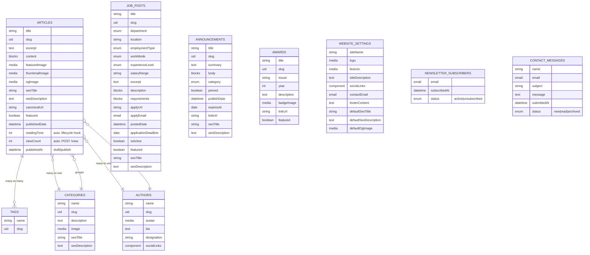

# Data Model & CMS Workflow

The entire system in two diagrams: **what's stored** (ERD) and **how it flows** (workflow).

## Entity-Relationship Diagram — every content type



**Three families of content:**

| Family | Types | Read by | Written by |
|---|---|---|---|
| **Editorial** | articles, authors, categories, tags, settings | public site | editors via admin |
| **Company** | job-posts, announcements, awards | public site | editors via admin |
| **Inbound** | newsletter-subscribers, contact-messages | admin only | public forms via custom endpoints |

`files` (media) is Strapi's built-in table — every `media` attribute is a foreign key into it, served via `/uploads/*` locally and Cloudinary in production.

## Full CMS workflow

```mermaid
flowchart TD
    subgraph ADMIN["Strapi Admin Panel — /admin"]
        A1["Editor writes/saves entry"]
        A2{"Draft or Publish?"}
        A3["DRAFT row<br/>published_at = NULL"]
        A4["PUBLISHED row<br/>published_at = now"]
    end

    subgraph BOOT["Boot-time (every deploy)"]
        B1["permissions.ts → 18 public actions"]
        B2["api-token.ts → sync scoped token"]
        B3["seed.ts → demo rows if missing"]
    end

    subgraph API["Content API — /api/*"]
        C1["Auto CRUD routes<br/>find / findOne"]
        C2["Custom: POST /view, /subscribe, /submit"]
        C3["Rate limiter<br/>anonymous ≤120/min"]
        C4["Token check<br/>valid Bearer → bypass"]
    end

    subgraph LIFE["Lifecycle hooks"]
        L1["article: readingTime + publishedDate defaults"]
        L2["all types: notify-frontend"]
    end

    subgraph DB[("PostgreSQL / Neon")]
        D1["published rows"]
        D2["draft rows<br/>(API-invisible)"]
    end

    subgraph FE["Next.js (Vercel)"]
        F1["SSG pages<br/>generateStaticParams"]
        F2["ISR cache<br/>revalidate 3600s"]
        F3["/api/revalidate<br/>secret-gated"]
        F4["Proxy POSTs<br/>contact · newsletter · view"]
    end

    subgraph USER["People"]
        R["Reader"]
        C["Candidate / Contact"]
    end

    A1 --> A2
    A2 -- "Save" --> A3 --> D2
    A2 -- "Publish" --> A4 --> D1
    D2 -.->|"filtered out by default"| C1

    BOOT --> API
    D1 --> C1
    C3 --> C1
    C4 -.->|"valid token"| C1

    C1 -->|"JSON + Bearer token"| F2
    C2 -->|"public forms"| F4
    F2 --> F1
    F4 --> C2

    L1 --> D1
    D1 --> L2
    L2 -->|"POST secret"| F3
    F3 -->|"revalidatePath '/' layout"| F2

    F2 --> R
    C -->|"POST /api/contact, /newsletter"| F4
    C -->|"clicks /careers/[slug]"| F2
```

## Reading the workflow

**Write path (editorial):**
`Admin → Save/Publish → DB row → lifecycle hook → POST /api/revalidate → Vercel purges layout cache → next request re-renders from fresh API JSON → cached for everyone else`

**Read path (public):**
`Reader → Vercel edge (cache HIT, ~0 Strapi calls) → or MISS → GET /api/* with scoped Bearer token → JSON → rendered HTML → cached ≤1h`

**Inbound path (forms):**
`Visitor → same-origin Next.js proxy (/api/contact etc.) → validated custom Strapi endpoint → DB row (new/unsubscribed status) → admin-only visibility`

**Draft discipline:** `published_at IS NULL` rows are filtered by the document service before they ever reach the API — that's why "Save" alone never shows on the site.

**Trust boundaries:**
- Public role: `find`/`findOne` on 9 content types + 3 custom POSTs — nothing else
- Scoped API token: same actions, but **bypasses rate limiting** (server-to-server)
- Admin session: everything, incl. drafts, content-type builder, media library
- `/api/revalidate`: only callable with the shared secret
